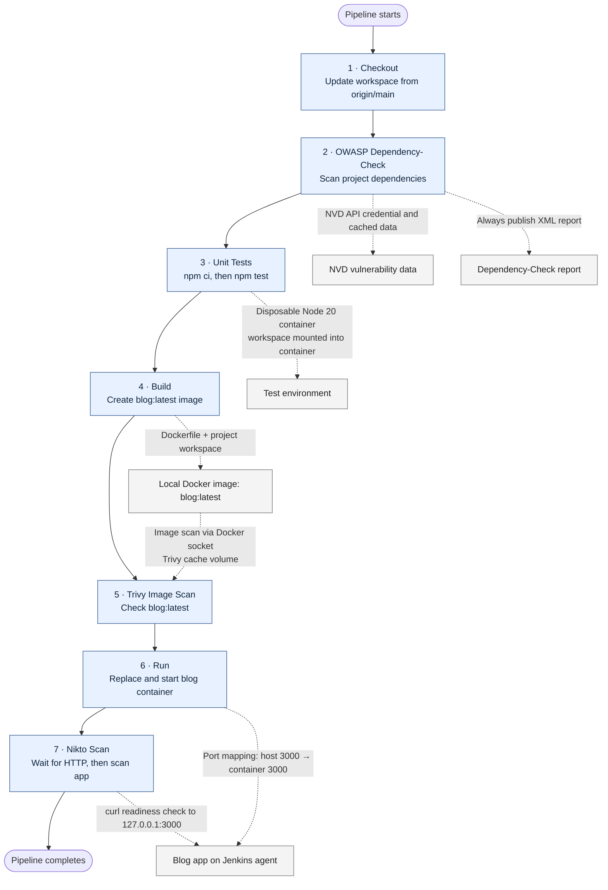

# Pipeline architecture

## At a glance

The Jenkinsfile defines one sequential pipeline. Each numbered stage must complete
before the next stage starts. A stage failure normally stops the pipeline, except
that the Dependency-Check report publisher is configured to run even if its scan
stage fails.

## What each stage does

### 1. Checkout

- Runs `git pull origin main` in the Jenkins workspace to update the checked-out
  source from the `main` branch.
- The resulting workspace is used by the dependency scan, tests, and image build.

### 2. OWASP Dependency-Check

- Runs the Jenkins Dependency-Check installation against the project to identify
  known vulnerabilities in its dependencies.
- Uses the Jenkins credential ID `nvd-api-key` to access NVD data and stores
  Dependency-Check data under `$HOME/.dependency-check/data` for reuse.
- `--failOnCVSS 7` sets the configured failure threshold to CVSS 7.
- The `post { always { ... } }` action publishes
  `**/dependency-check-report.xml` whether or not the scan succeeds. This is a
  reporting action, not another pipeline stage.

### 3. Unit Tests

- Starts a disposable `node:20-alpine` container and removes it when the command
  exits (`--rm`).
- Bind-mounts the Jenkins workspace at `/usr/src/app` and runs from that
  directory, so test files and npm manifests come from the checked-out project.
- Installs Python, pip, and native build tools required by dependencies, runs
  `npm ci` for a lockfile-based install, then executes `npm test`.
- The container is used for testing; it is not the container used to run the
  application later.

### 4. Build

- Runs `docker build --pull` using the repository's `Dockerfile` and workspace
  as the build context.
- Tags the resulting local image as `blog:latest`. The Dockerfile uses Node 20
  Alpine, installs production npm dependencies, copies the app, and configures
  it to listen on port 3000 as the non-root `node` user.

### 5. Trivy Image Scan

- Runs Trivy in a container to scan the locally built `blog:latest` image for
  vulnerabilities, limited to HIGH and CRITICAL severity.
- Mounts the host Docker socket so Trivy can inspect the local image and a Docker
  volume at `/root/.cache/` to retain its scan cache.
- The current command does **not** specify `--exit-code 1`; therefore, reported
  vulnerabilities alone do not make Trivy return a failing status to Jenkins.

### 6. Run

- Attempts to stop and remove any existing container named `blog`; errors from
  those cleanup commands are ignored with `|| true`.
- Starts the image in detached mode as a container named `blog` and maps host
  port 3000 to container port 3000.
- This runs the app on the Jenkins agent for the following scan. The Jenkinsfile
  does not show a separate production deployment or cleanup of this container.

### 7. Nikto Scan

- Checks `http://127.0.0.1:3000/` with `curl` to verify that the container is
  responding before scanning.
- Retries up to 30 times, sleeping 2 seconds between unsuccessful attempts.
  If it never becomes reachable, prints the container logs and fails the stage.
- After readiness succeeds, runs `nikto -h http://127.0.0.1:3000` against the
  running application. A failing Nikto command fails this stage.

## Pipeline behavior and requirements

- **Execution host:** `agent any` means Jenkins can select any eligible agent;
  that agent needs Docker and the tools/plugins referenced by the Jenkinsfile.
- **Ordering:** Checkout → Dependency-Check → Unit Tests → Build → Trivy → Run →
  Nikto. Later stages normally do not run after an earlier stage fails.
- **External data:** Dependency-Check needs its configured NVD credential and
  NVD data access. Nikto must be installed on the Jenkins agent.
- **Reports:** Dependency-Check XML is published by its always-run post action.
  The Jenkinsfile does not define a separate Trivy report publisher.
- **Deployment scope:** The `Run` stage starts a container locally on the
  Jenkins agent; it is a test/scan target, not evidence of production deployment.
